# Раскадровка и спецификация анимаций — v3.1 «אותיות שגרים בהן»

> **v3.1 — текущая версия:** v3 после второго раунда жюри из четырёх судей (Awwwards, доступность и достоинство, иврит, техника). Что изменилось и почему — [research/06, раздел 6](../research/06-jury-v2-to-v3.md#6-раунд-2-жюри-смотрит-v3) и [README прототипа](README.md#что-изменилось-после-второго-раунда-жюри-v31).
>
> **v3** Направление выбрали три независимых судьи: среднее 7.71 по шкале Awwwards против 7.33 и 7.06 у двух других концепций ([research/06](../research/06-jury-v2-to-v3.md)). Предыдущие версии сохранены: v2 — [`storyboard/v2/`](storyboard/v2/) и живая копия [`v2/`](v2/), v1 — [`storyboard/v1/`](storyboard/v1/).
>
> Кадры сняты Playwright с живого прототипа: десктоп 1440×900, iPhone 13 (390×844). Обзорные листы: [`_overview-home-desktop.jpg`](storyboard/_overview-home-desktop.jpg), [`_overview-home-mobile.jpg`](storyboard/_overview-home-mobile.jpg), [`_overview-inner.jpg`](storyboard/_overview-inner.jpg).
>
> Фото **временные**, взяты с текущего сайта (без узнаваемых лиц). Все прошли одну цветокоррекцию и кадрирование «под комнату» ([`scripts/build_prototype_images.py`](../scripts/build_prototype_images.py), `--v3`). Тексты на иврите опираются только на подтверждённые факты ([content/README.md](../content/README.md#сверка-фактов-из-брифа)). Тексты «בשפה פשוטה» — черновик для специалиста по פישוט לשוני.

## Идея в одном предложении

Пять еврейских букв, чьи названия — слова дома: **ב** (בית, дом), **כ** (כף, ладонь), **ס** (סמך, опора), **ל** (למד, учиться), **ד** (דלת, дверь). Ярлыков у букв на сайте нет (метки «כ׳ ס׳ ל׳ ד׳» читались как букварь): имя каждой буквы звучит в заголовке её разворота — «בית», «לסמוך», «ללמוד», «הדלת» (у כ — в подписи «בכף היד: …» над списком работ) — и один раз прозой в колофоне. Буквы становятся архитектурой страницы, а их внутренние пространства — **комнатами**, где показана жизнь. Фото живут только внутри букв, на бумаге. Каждый разворот «подвешен» к тонкой линейке — שרטוט, как строка у писца. **Текст никогда не двигается — двигается только архитектура.**

| Буква | Где | Что в «комнате» |
|---|---|---|
| ב — בית | Обложка главной; мини-ב в индексе домов; обложка страницы дома | Двое идут по дорожке; небо потолка нового крыла |
| כ — כף | «ידיים שיוצרות» на цитрусовом фоне | Работа жильцов, которую выбирают из списка: три горшка и совы |
| ס — סמך | «יש על מי לסמוך» | Мандала жильцов, целиком и без изменений |
| ם (финальная) | «שמיים» в году 2021 | Окно в небо |
| ל — למד | «עבודה עם משמעות. מקום ללמוד ולגדול.» | Единственная буква, которая поднимается над линейкой: стоит у дальнего края и пересекает её |
| ד — דלת | «הדלת פתוחה. בואו להכיר» на ирисовом фоне | Широкая ד на весь разворот (как буквы, которые писец растягивает в строке); форма визита стоит в её проёме |

Контуры букв взяты из Frank Ruhl Libre (OFL) при весах 800 и 300 и совпадают по точкам, поэтому вес можно плавно менять. Экспорт: [`scripts/build_letters.py`](../scripts/build_letters.py) → [`assets/letters.json`](assets/letters.json). «Комната» буквы измерена по растру глифа, фото обрезано по ней через `clip-path: inset()`.

## Общие правила движения

| Правило | Как реализовано |
|---|---|
| Текст не двигается | Заголовки и абзацы нарисованы окончательно с первого кадра: нет появлений, нет посимвольных и построчных анимаций. Двигаются только буквы-архитектура и линии |
| Без анимационных библиотек | v3 не загружает GSAP. Всё движение — несколько строк в [`assets/js/v3.js`](assets/js/v3.js) (requestAnimationFrame, IntersectionObserver) и CSS |
| Без закреплений на JS | Нет ScrollTrigger-pin и перехвата прокрутки. Единственное закрепление — CSS `position: sticky` на обложке (≥ 1024×700, обложка 150svh, в пределах правила жюри «не выше 160vh»), и только когда ב действительно движется: не в reduced motion, не в спокойном режиме и не в простом языке |
| Нет бесконечных циклов | По времени анимируется только вход обложки (≤ 1.8 с) и одноразовые события (блик на стекле мандалы, перемычка двери). Остальное привязано к прокрутке. WCAG 2.2.2 соблюдается |
| Три способа убрать движение | 1) системная `prefers-reduced-motion`; 2) «הפחתת תנועה»; 3) «מצב רגוע» (спокойный режим). Переключатели в панели «תצוגה» в шапке (десктоп), в меню (телефон) и в подвале. Выбор запоминается и объявляется голосом через `role="status"` |
| Производительность | Вход обложки — только CSS `transform`, LCP — настоящий `` с preload. JS: v3.js ≈ 13 КБ + site.js ≈ 21 КБ (≈ 12 КБ по сети с brotli), оба с `defer`. Lighthouse mobile — в [README](README.md#проверки-v31) |

### Общие эффекты

| Эффект | Триггер | Длительность | Easing | Мобильный | Reduced motion / спокойный режим |
|---|---|---|---|---|---|
| Колонтитул (название разворота под словесным знаком в шапке) | разворот пересекает верх экрана (IntersectionObserver) | мгновенно | — | Скрыт (< 70em) | То же |
| Линия прогресса чтения под шапкой | прокрутка страницы (CSS `animation-timeline: scroll()`) | — | linear, `scaleX` 0→1 | То же | Видна (это указатель, а не анимация); в спокойном режиме скрыта |
| Точка в заголовках — квадратная тессера | статично | — | — | То же | То же; в forced colors — обычная точка |
| Строки индекса и вакансий | hover и focus | 0.55 с / 0.3 с | `--nh-ease-out`, заливка справа налево (`scaleX`), стрелка на 8 px вперёд | Без hover: только focus | Без перехода |

---

## Главная

### Обложка — «בית. לחיים.»

| Покой | Прокрутка 225 px | Прокрутка 450 px (вес 300) | Телефон |
|---|---|---|---|
| 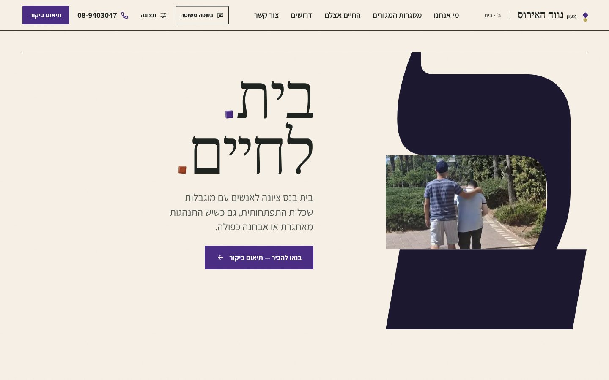 | 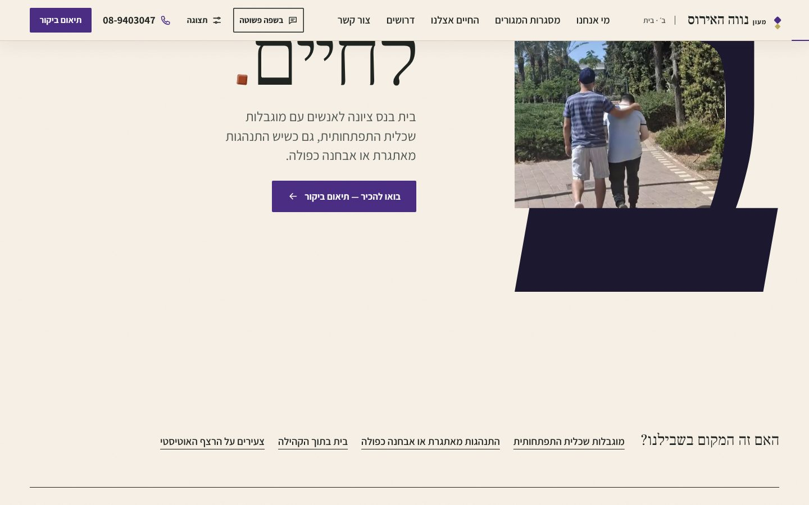 | 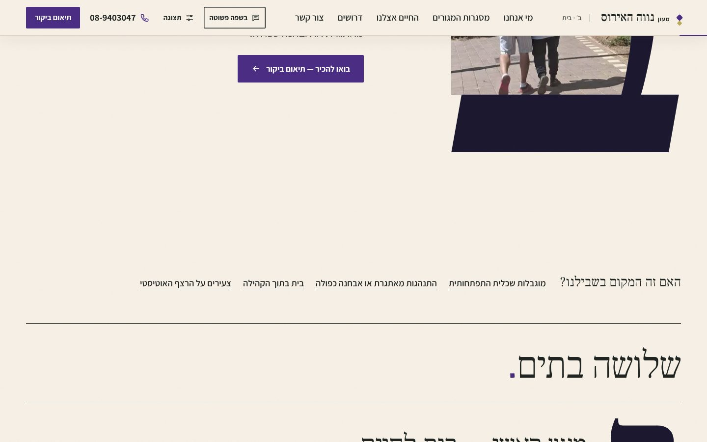 | 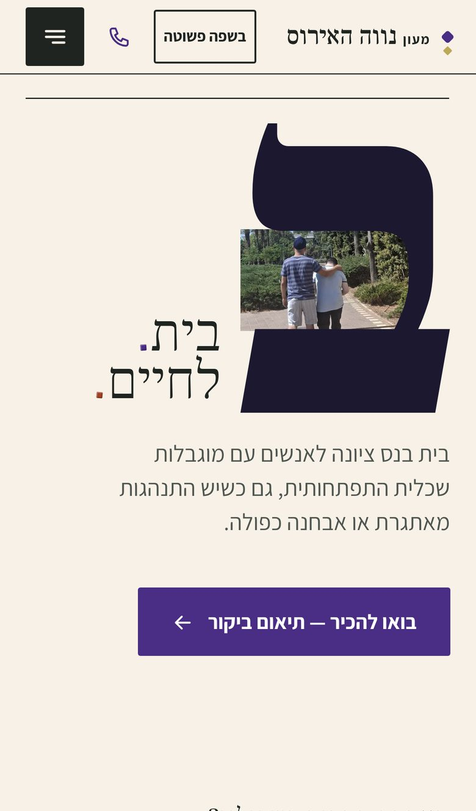 |

**Сообщение за 10 секунд:** дом в Нес-Ционе для людей с מוגבלות שכלית התפתחותית, в том числе с התנהגות מאתגרת или אבחנה כפולה; можно прийти познакомиться. На экране не больше пяти элементов: ב с «комнатой», H1, одна фраза, кнопка и телефон в шапке. **На телефоне** ב стоит рядом с H1, фраза и кнопка — под ними: кнопка видна на первом экране (iPhone 13 в Safari, 390×664). Планшет — две колонки, как десктоп. Мобильная панель визита появляется, когда кнопка обложки ушла за верх экрана.

| Элемент | Триггер | Длительность / задержка | Easing | Мобильный | Reduced motion |
|---|---|---|---|---|---|
| Линейка | загрузка (CSS) | 0.6 с, задержка 0.05 с | `--nh-ease-out`, `scaleX` 0→1 справа налево | То же | Сразу |
| Бумажная шторка сходит с буквы | загрузка (CSS) | 1 с, задержка 0.25 с | `--nh-ease-in-out`, `scaleX` 1→0 к левому краю (по направлению чтения) | Нет | Нет |
| Фото в «комнате» оседает | загрузка (CSS) | 1.8 с, задержка 0.2 с | `--nh-ease-out`, `scale` 1.06→1 (никогда не прозрачность: это LCP) | То же | Сразу |
| **Дом становится просторнее** | прокрутка. Обложка высотой 150svh; ב и текст закреплены (CSS sticky), пока вес меняется: t = прокрутка / (высота обложки − высота экрана), т. е. весь переход занимает полэкрана и **целиком происходит на экране** | следует за пальцем (rAF) | linear по весу: контур ב интерполируется 800→300, «комната» (`clip-path`) растёт ~ на 50%, внизу появляются шаги людей по дорожке | 800→500, без закрепления; переход заканчивается, пока «комната» видна минимум на ~80% | Вес 800, статично, обложка в один экран |
| H1, текст, кнопка | — | — | — | — | Нарисованы окончательно с первого кадра |

### Индекс домов — «שלושה בתים.»

| Десктоп | Строки | Телефон |
|---|---|---|
| 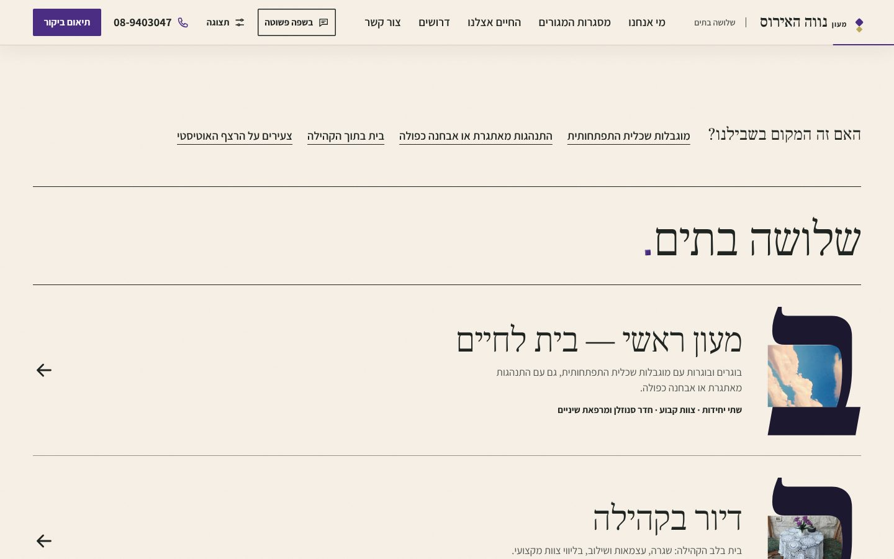 | 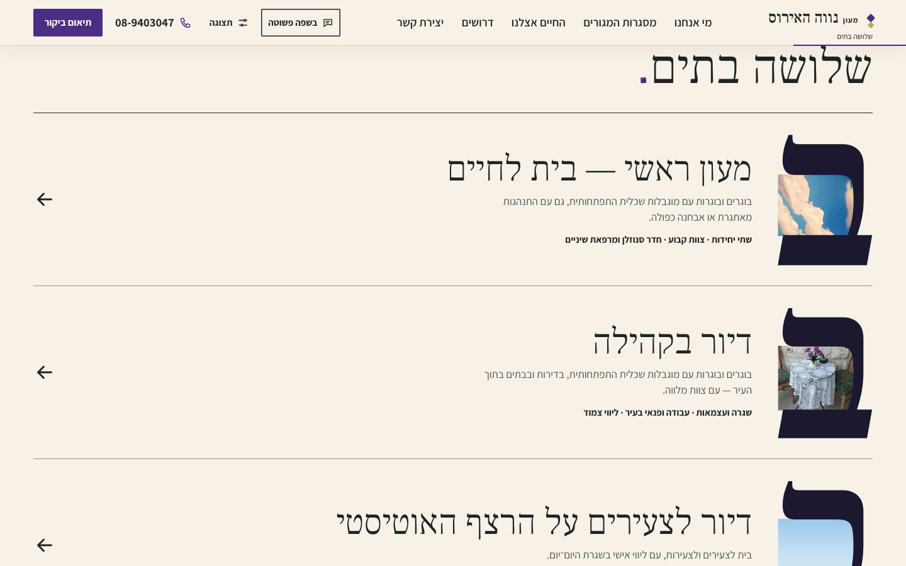 | 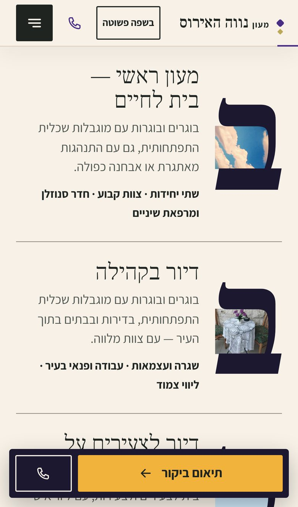 |

- **«האם זה המקום בשבילנו?»** — четыре ссылки-ответа, в том числе «התנהגות מאתגרת או אבחנה כפולה».
- **Три равные строки вместо карточек.** Каждая начинается мини-ב со своей комнатой: небо нового крыла (מעון ראשי), уголок дома с вязаной скатертью (דיור בקהילה), спокойное небо без фото для дома молодых людей на аутистическом спектре, пока нет согласованных снимков. Строка целиком — одна ссылка. Hover/focus заливает её «своим» цветом справа налево.
- **Переход на страницу дома:** мини-ב главного дома и обложка страницы связаны общим `view-transition-name: home-bet-1`. Буква «вырастает» в обложку (cross-document View Transitions; без поддержки страница просто открывается).

### «בשפה פשוטה» — переключатель всей страницы

| Блок | Главная в простом режиме | Телефон в простом режиме |
|---|---|---|
| 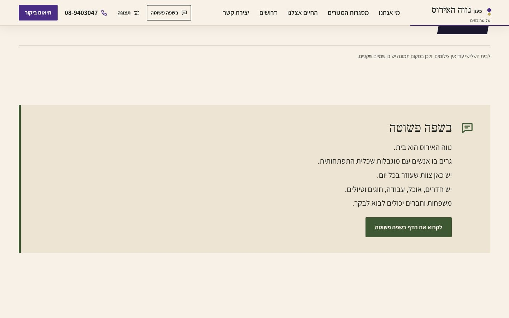 | 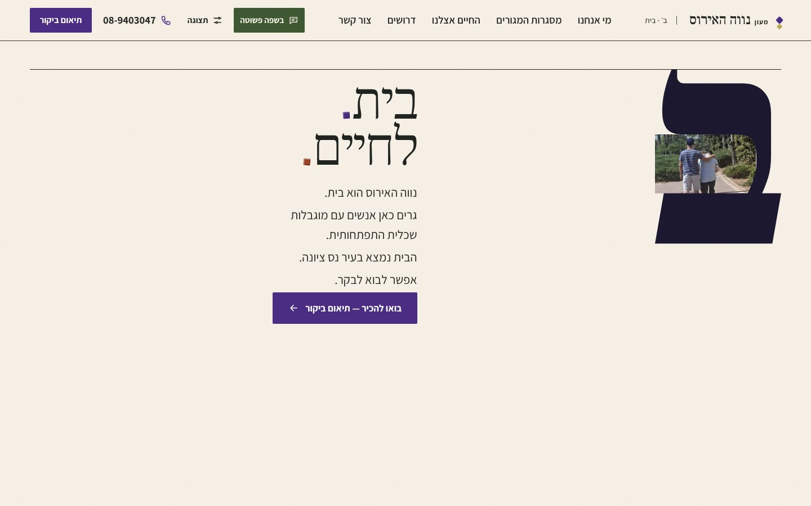 | 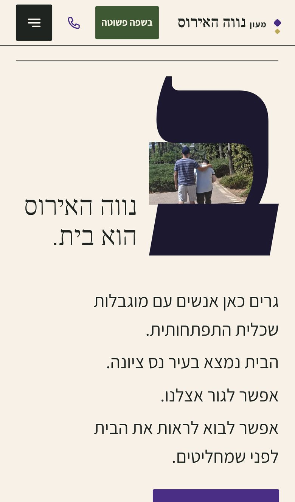 |

Кнопка в блоке и в шапке переключает **всю страницу**. В каждом развороте есть короткая версия (3–6 строк, одна мысль в строке, 22 px). Большие буквы складываются в небольшие, фото остаются с подписями. Место чтения сохраняется: разворот у верха экрана остаётся на том же месте. Объявление «הדף מוצג עכשיו בשפה פשוטה.» уходит через `role="status"`. Режим запоминается и открывается ссылкой `?plain=1`; класс ставится до первой отрисовки.

### День — «החיים קורים כאן.»

| Десктоп | Глаголы | Телефон |
|---|---|---|
| 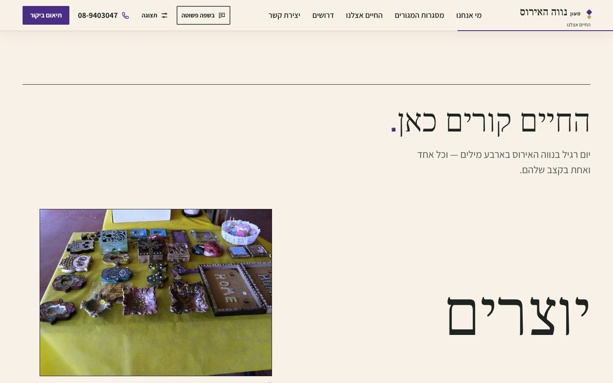 | 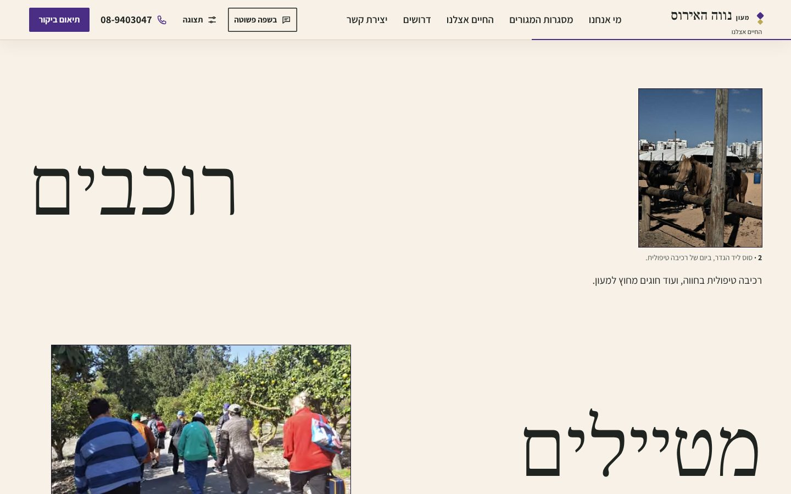 | 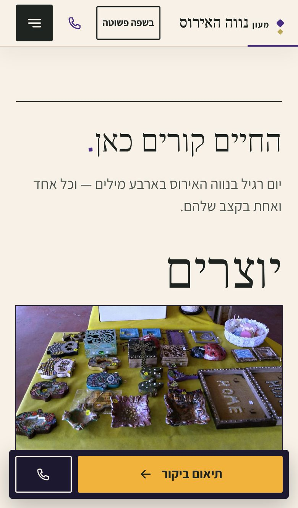 |

Четыре глагола, подлежащее — жильцы: **יוצרים**, **רוכבים**, **מטיילים**, **מארחים**. Глагол — настоящий H3, набранный огромным Frank Ruhl 300 без отрицательного трекинга. Фото — «отпечатки»: прямой срез, тонкая линия 1 px цвета чернил, нумерованная подпись («1 · …»), без белых полей и теней. У «מארחים» — уголок, где сидят с гостями. Движения нет: разворот нарочно спокойный.

### כ — כף: «ידיים שיוצרות.»

| Десктоп | Телефон |
|---|---|
| 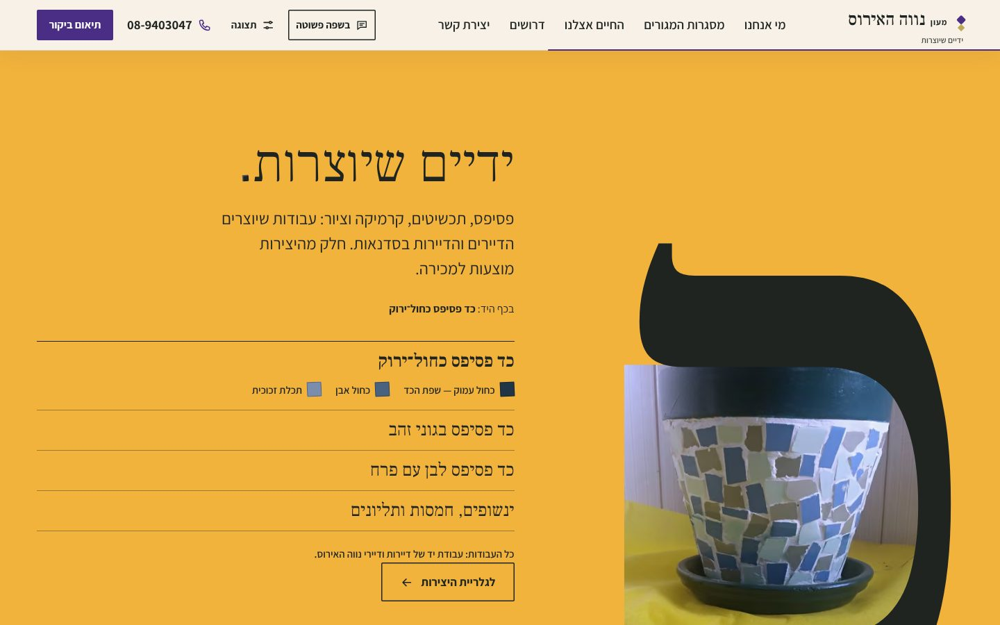 | 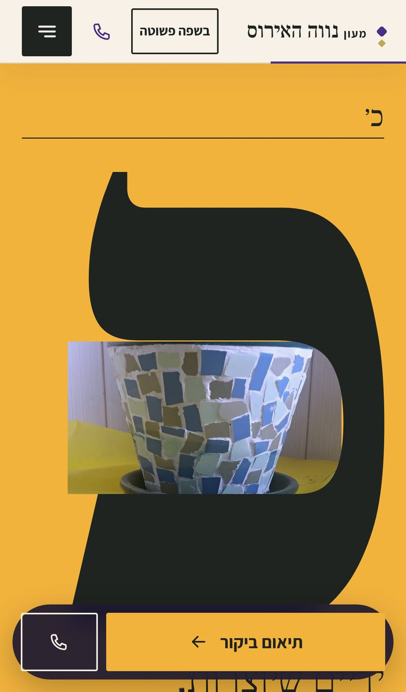 |

Цитрусовый разворот (цвет жёлтой скатерти на снимках работ), без линейки: разворот открывает сама буква. Огромная כ держит в «ладони» выбранную работу, а её основание срезано нижним краем разворота — ладонь держит работу снизу. Подпись «בכף היד: …» называет выбранную работу (в ней звучит имя буквы). Список из четырёх работ — кнопки `aria-pressed`. Выбор меняет работу в ладони (0.3 с прозрачность, только у фото) и открывает **цветовые кредиты**: три цвета, снятые пипеткой с этой работы, с названиями. Кредит: «עבודת יד של דיירות ודיירי נווה האירוס».

### ס — סמך: «יש על מי לסמוך.»

| Десктоп | Телефон |
|---|---|
| 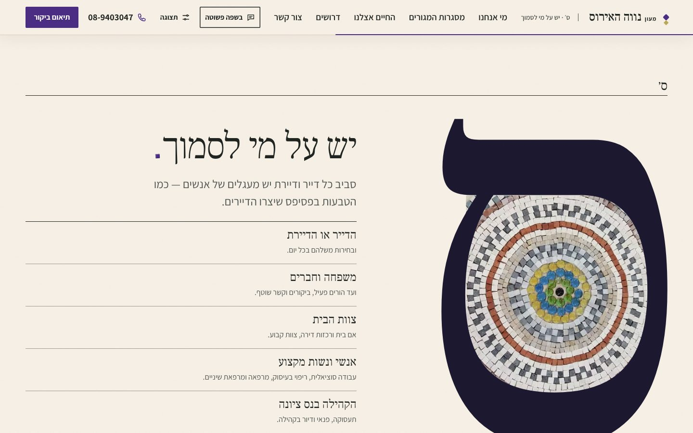 | 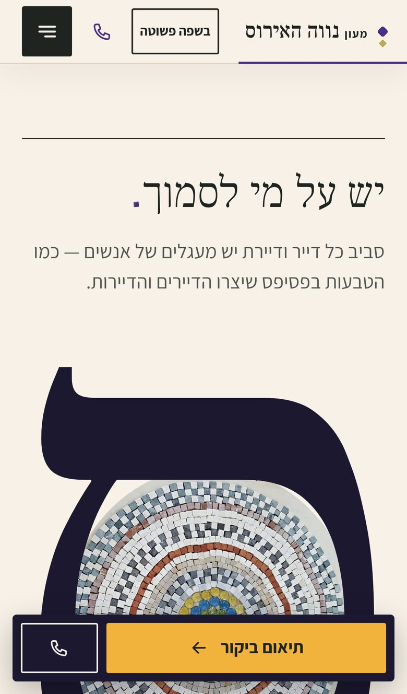 |

ס стоит в центре разворота: слова с одной стороны, круги опоры с другой. Мандала жильцов в «комнате» ס **целиком: мы её не режем и не вращаем** (пока нет согласия авторов). Квадратное фото работы вписано в эллипс по внутреннему контуру буквы (режим сборки `fit="whole"`), фон вокруг — серый тон рабочего стола. Нижний ряд плиток обрезан уже на исходном снимке; нужно новое фото. Рядом шесть кругов опоры: сам жилец или жилица, семья и друзья (ועד הורים), команда дома, специалисты, город, надзор министерства.

| Элемент | Триггер | Длительность | Easing | Мобильный | Reduced motion / спокойный режим |
|---|---|---|---|---|---|
| Блик по стеклу мандалы | секция в кадре (IntersectionObserver), **один раз** | 1.7 с, задержка 0.2 с | `--nh-ease-in-out`, полоса света справа налево (`transform`) только по стеклянному центру (27% стороны фото) и внутри того же эллипса, что и работа: на букву не выходит | То же | Нет |
| Кольцо круга опоры | hover/focus пункта списка (CSS `:has()`) | 0.3 с | ease, тонкое цитрусовое кольцо поверх мандалы, радиусы сняты с колец самой работы (край стекла, серая полоса, терракотовое кольцо, светлая полоса, розовое кольцо); саму работу не меняет | То же | Без перехода |

Центр мандалы не подписан и не обводится: такая метка читается как «глаз» или мишень.

### Годы — «כמעט 70 שנה של בית.»

| Десктоп | Телефон |
|---|---|
| 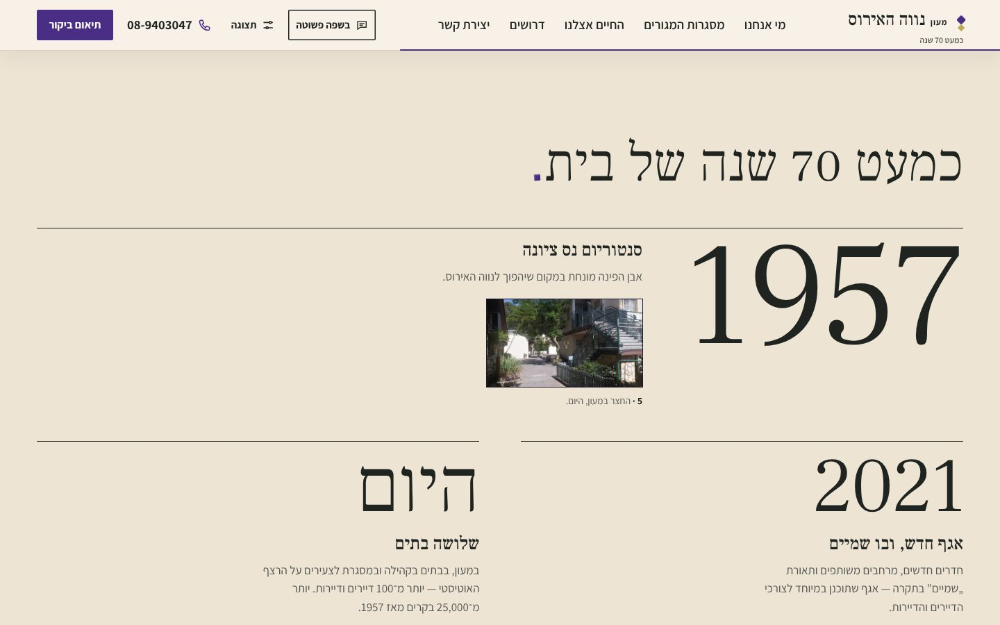 | 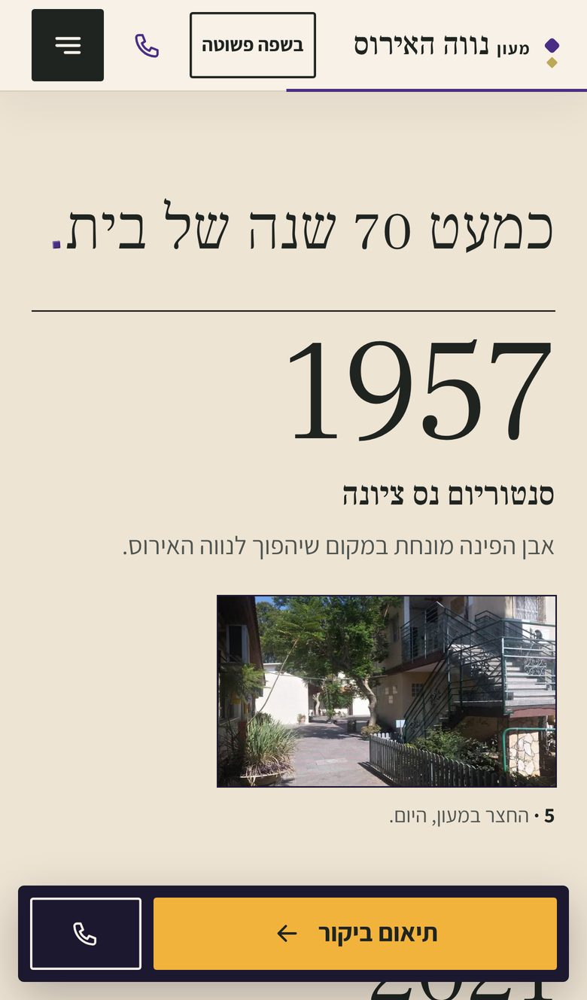 |

Без линейки: разворот открывает «1957» плакатного размера (до 240 px) — первая запись растянута на всю ширину. Дальше 2021 (новое крыло) и היום (три дома, «יותר מ־25,000 בקרים מאז 1957»). В слове **שמיים** финальная ם — окно: в её квадратной «комнате» небо потолка нового крыла. Облака дрейфуют на ±4% вместе с прокруткой (CSS `animation-timeline: view()`; в Firefox и при reduced motion — статично).

### Голоса, шаги, вакансии

| Голоса (ночь) | «צעד צעד» | ל — вакансии |
|---|---|---|
| 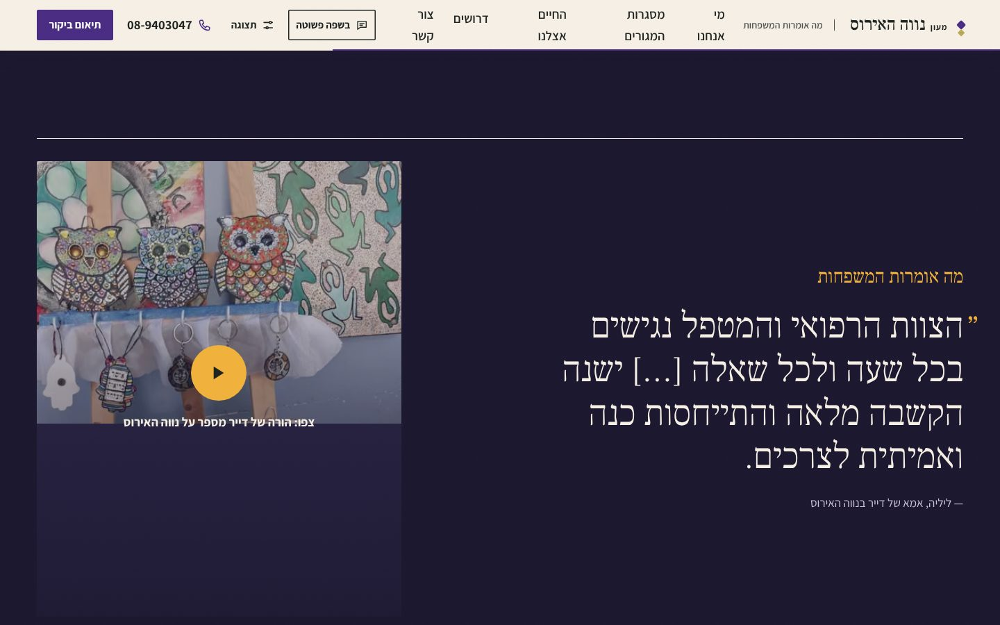 | 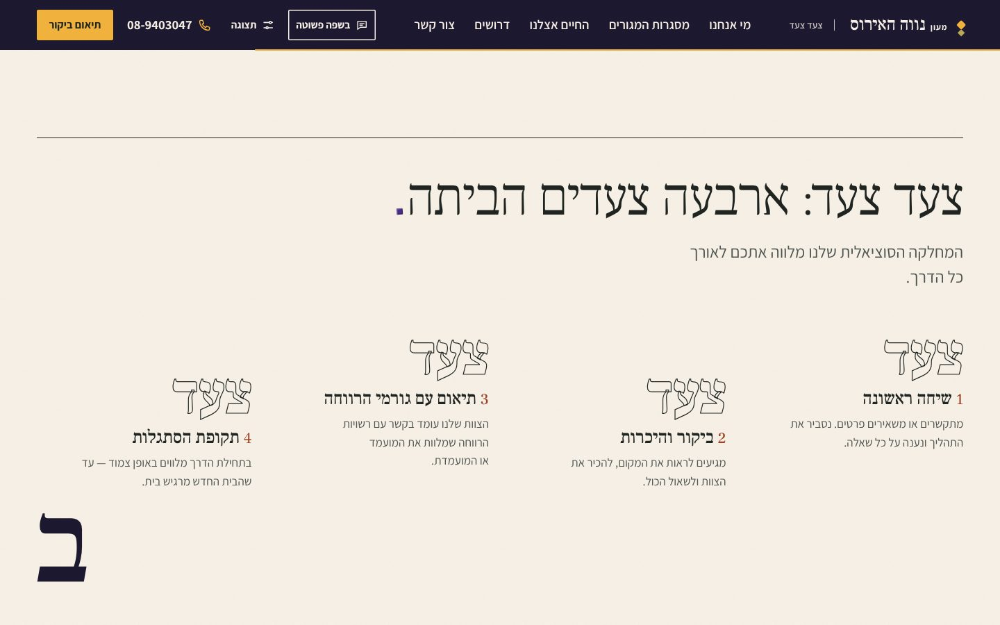 | 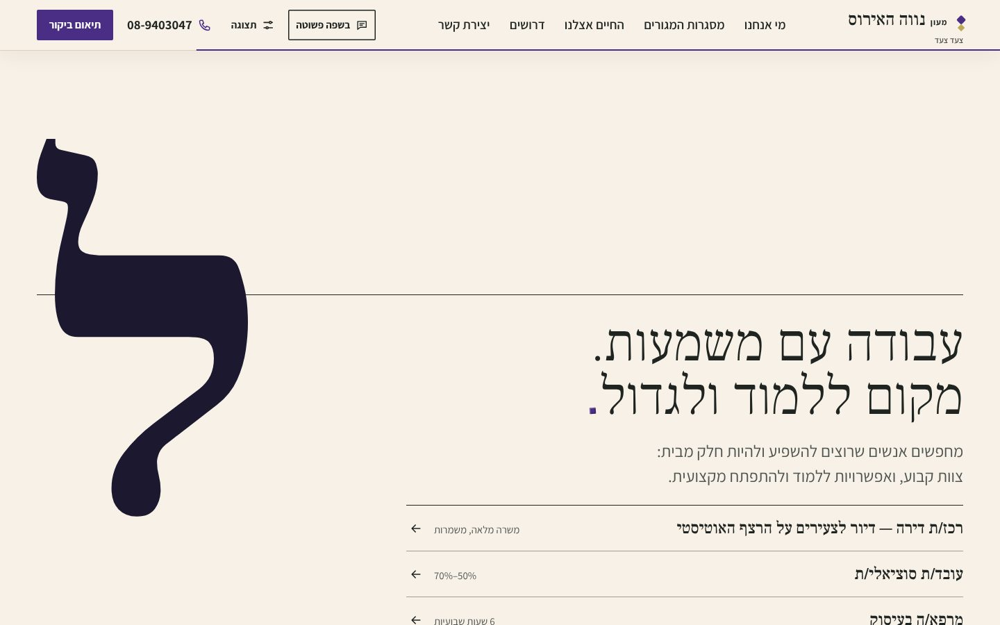 |

- **Голоса:** разворот открывает сама цитата, заголовок H2 есть только для скринридера. Цитата о жизни, а не о медицине: «הבן שלי וחבריו מבלים מחוץ לכותלי המוסד מדי שבוע» — дословная часть предложения из письма мамы жильца, без фамилии. В простом режиме — косвенная речь («היא כתבה ש…»). Видео — квадратный «отпечаток» с подписью под ним, квадратная кнопка воспроизведения, работы жильцов на постере не затемнены; YouTube грузится только после согласия.
- **«צעד צעד: ארבעה צעדים הביתה.»** — четыре шага приёма. **Не проверено:** на сайте заказчика порядка приёма нет, шаги и фраза про המחלקה הסוציאלית — наш черновик, их нужно подтвердить у заказчика. Над каждым шагом декоративное «צעד» мягким сплошным тоном (генерируемый текст, `aria-hidden`), без контура. Маленькая ב в конце убрана.
- **ל — «עבודה עם משמעות. מקום ללמוד ולגדול.»** ל стоит у дальнего (левого) края и пересекает линейку: единственная буква, которая поднимается над строкой. Роли с формами обоих родов — строки-ссылки; в простом режиме без косых черт («רכז או רכזת דירה»).

### ד — דלת: «הדלת פתוחה. בואו להכיר.»

| Дверь | Перемычка в движении / форма | Телефон |
|---|---|---|
| 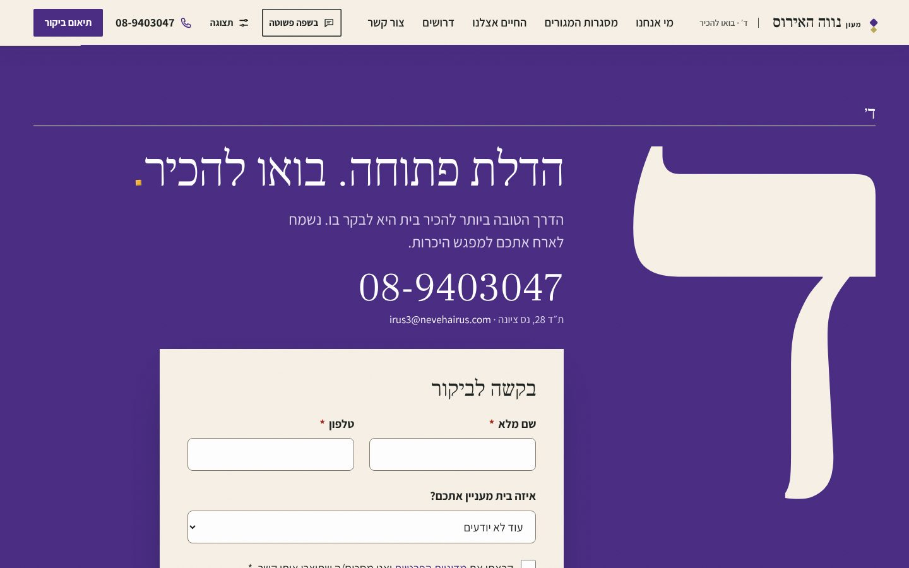 | 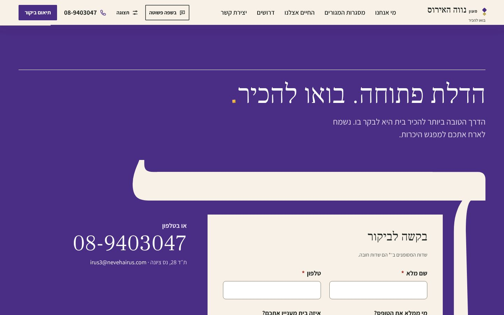 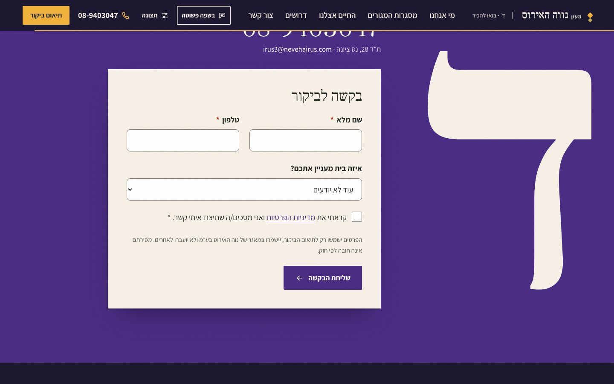 | 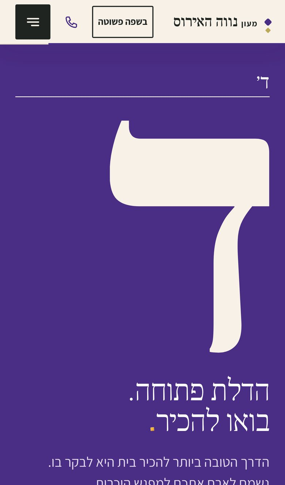 |

| Элемент | Триггер | Длительность | Easing | Мобильный | Reduced motion |
|---|---|---|---|---|---|
| Дверь открывается: перемычка широкой ד дотягивается до дальнего края | проём в кадре (IntersectionObserver), один раз | 0.9 с | `--nh-ease-in-out`; перемычка от 60% до 100% длины, флажок ד едет вместе с её концом (CSS `@property --open`) | То же (k = 0.4 px на единицу шрифта) | Дверь открыта сразу |

Как построена ד: голова буквы (конец перемычки и нога) — у правого края, флажок — у левого, между ними прямая перемычка; всё в единицах Frank Ruhl Libre 300 (`--k` — размер одной единицы). Нога продолжается до «пола» разворота. Форма — на бумаге, без тени, в проёме; телефон и адрес — слева в том же проёме. Самые узкие телефоны (< 24em): только перемычка, форма на всю ширину.

Форма: имя, телефон, «מי ממלא את הטופס?» (первый вариант — «אני, בשביל עצמי»; есть «תומך או תומכת בקבלת החלטות»), какой дом, согласие, уведомление по §11 закона о защите приватности (общее для обеих форм, с простым вариантом). Ошибки — после отправки, сводка с фокусом. На телефоне панель «תיאום ביקור» уходит, пока заполняется поле, и прячется у формы и подвала.

### Подвал — колофон

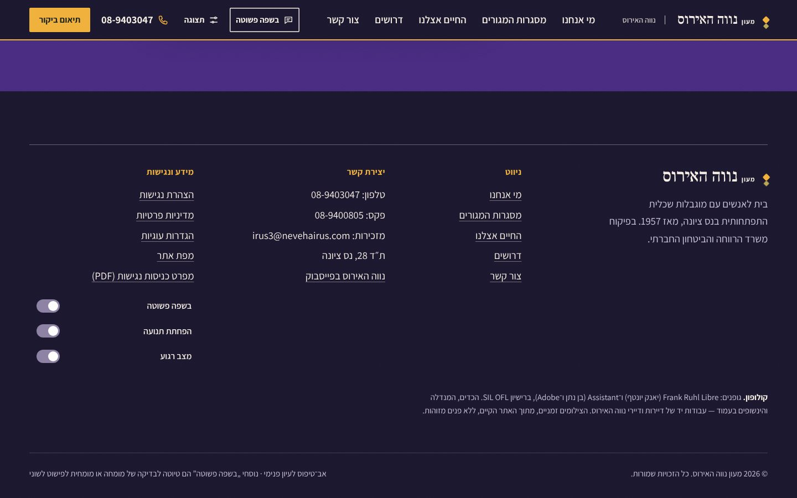

Контакты, навигация, ссылки на הצהרת נגישות и приватность, «הגדרות עוגיות», три переключателя отображения. **Колофон:** шрифты и их авторы (יאנק יונטף; בן נתן и Adobe), кредит жильцам за работы и честная пометка: фото временные, без узнаваемых лиц.

### Шапка, панель «תצוגה», меню

| Панель «תצוגה» | Меню на телефоне | Панель визита |
|---|---|---|
| 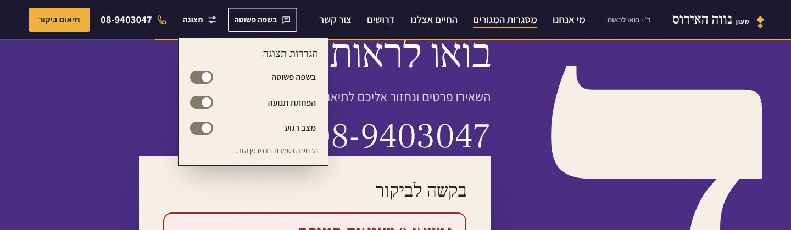 | 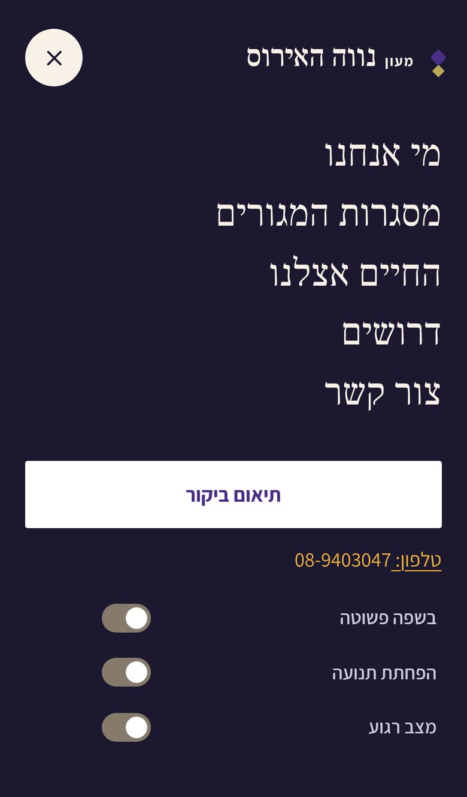 | 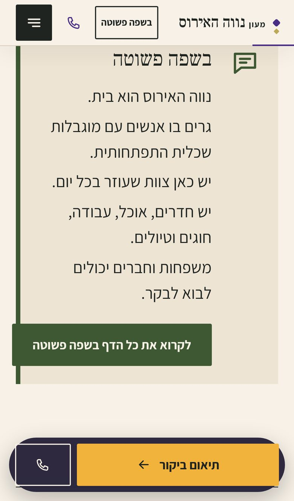 |

- Шапка на бумаге с линией 1 px. Над тёмными разворотами она переключается на тёмную тему. Точки перелома — в em (70em, 80em, 90em): при крупном шрифте браузера шапка сама переходит в компактный вид. Колонтитул стоит под словесным знаком и не участвует в строке, поэтому никогда не переносит навигацию.
- Кнопка «בשפה פשוטה» видна всегда, даже на телефоне.
- **«תצוגה»** — раскрывающаяся панель: фокус переходит внутрь, Esc закрывает её и возвращает фокус, клик снаружи тоже закрывает.
- Меню на телефоне — нативный `<dialog>`.

---

## Страница дома — «מעון ראשי — בית לחיים»

| Обложка | Цифры | Галерея |
|---|---|---|
| 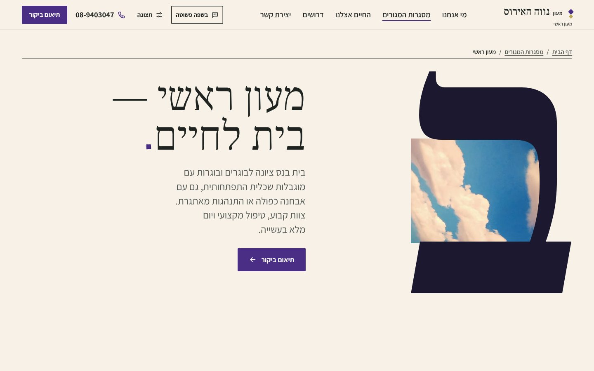 |  |  |
| **Что есть в доме** | **Истории (ночь)** | **Форма в двери** |
| 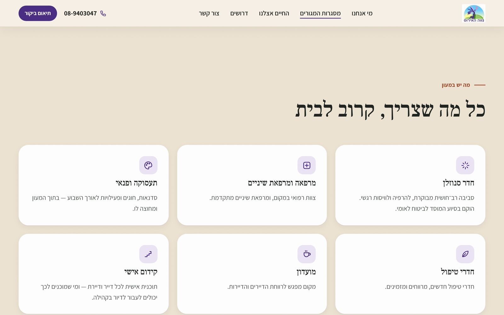 | 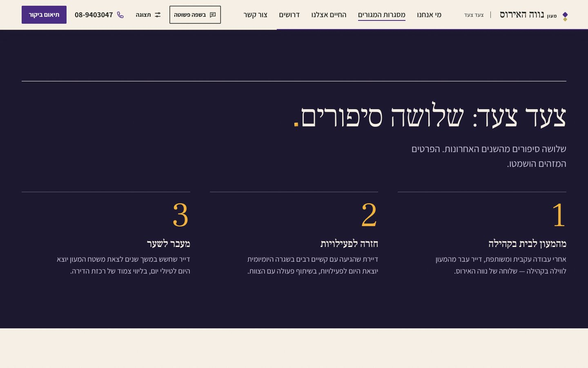 | 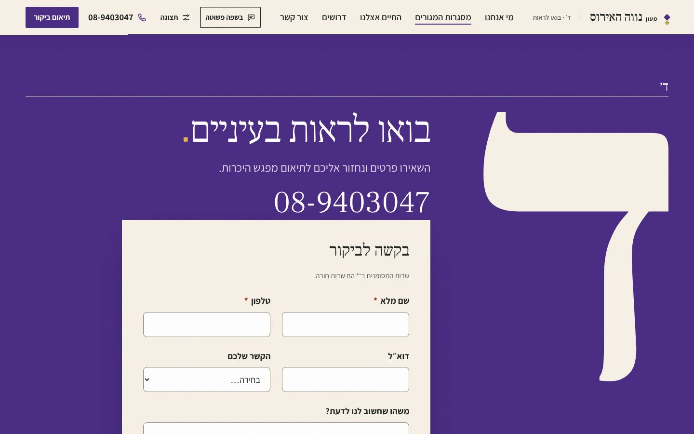 |

Телефон: [обложка](storyboard/inner-mobile-p1-cover.jpg) · [цифры](storyboard/inner-mobile-p2-glance.jpg) · [галерея](storyboard/inner-mobile-p3-gallery.jpg) · [форма](storyboard/inner-mobile-p7-visit.jpg). Состояния: [ошибки формы](storyboard/inner-desktop-p8-form-errors.jpg), [лайтбокс](storyboard/inner-desktop-p9-lightbox.jpg).

- **Обложка** — та же ב, что в индексе домов, но крупная и с небом нового крыла. Начинает с веса 600 и при прокрутке облегчается до 300.
- **Цифры** стоят на линейке, без карточек.
- **Галерея** — «отпечатки» с прямым срезом и линией 1 px, первым идёт обеденный стол, коридор — маленький; лайтбокс на нативном `<dialog>`.
- **«Что есть в доме»** — типографский список без иконок. Сюда, к «מרפאה ומרפאת שיניים», перенесена цитата мамы о медицинской и социальной команде.
- **Истории** — три шага, подлежащее — жилец или жилица; у каждой истории есть простой вариант.
- Блок «בשפה פשוטה», строки «להמשך קריאה» и дверь ד с полной формой визита.

## Reduced motion и спокойный режим

| Обложка | После прокрутки | Дверь |
|---|---|---|
|  | 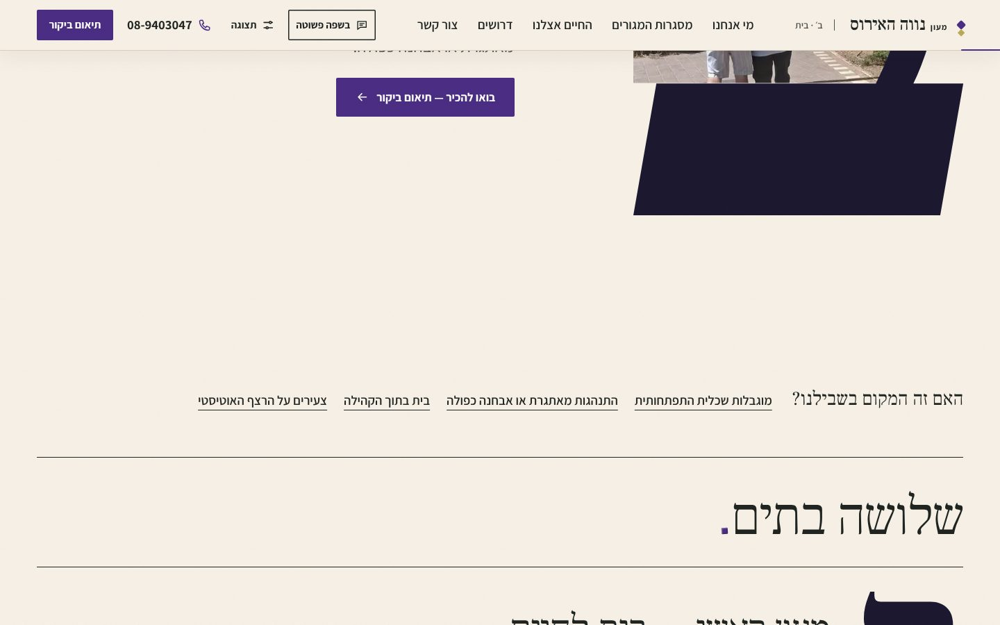 | 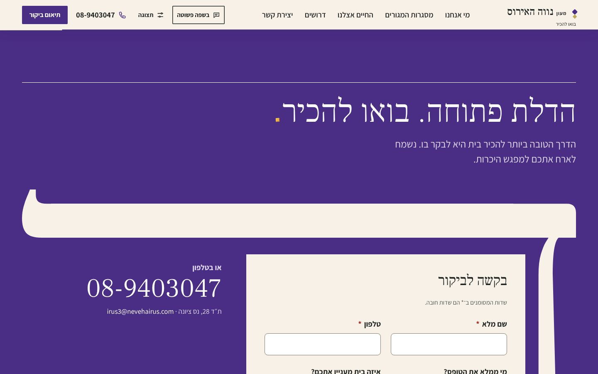 |

То же содержание и все функции, без движения. **Спокойный режим** дополнительно убирает яркий цитрусовый фон (песочный вместо него) и снижает насыщенность фото на 30%. Его стоит включать по умолчанию на странице дома для молодых людей на спектре.

## Переходы между страницами

Cross-document View Transitions (`@view-transition { navigation: auto; }` — только при `prefers-reduced-motion: no-preference`; кнопка «הפחתת תנועה» и спокойный режим тоже их гасят). Общая буква ב индекса и обложки страницы дома — `home-bet-1`, но имя ставится **только для этого пути**: клик по строке «מעון ראשי» в индексе называет её маленькую ב, а страница дома называет свою обложку в `pagereveal`, только если пришла именно так. Остальные переходы — обычное растворение страницы. При входе через переход обложка уже нарисована: «шторка» и оседание фото не играют (`html.nh-vt-in`). Баннер cookies имеет своё имя перехода и остаётся сверху.

**Якоря.** Плавная прокрутка — только для ссылок внутри страницы (`html:focus-within { scroll-behavior: smooth }`). Ссылка вида `index.html#door` с другой страницы ставит читателя на место сразу, без пролёта через всю главную.
